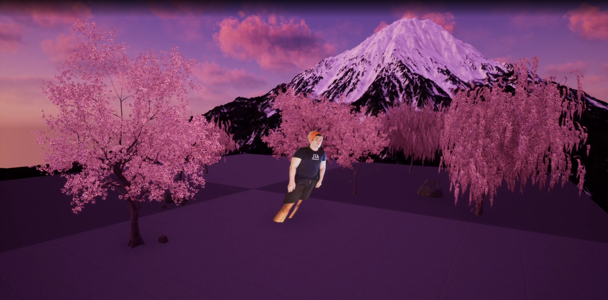

CloudCamPlugin
==============

A plugin that adds [CloudCam](https://github.com/storytold/cloudcam)-based actors to 
projects as well as a ZeroMq-based network poller to handle the protocol.

Based on this [Niagara point cloud technique](https://www.youtube.com/watch?v=TmG-XIxaLVQ)

Installation
------------
Place in your project's `Plugins/` directory. You may need to rename this directory
from `CloudCamPlugin` to `CloudCam`.

This also requires the [ZeroMQ plugin](https://github.com/storytold/UnrealZeroMQ) to 
be installed as well.

See this tutorial on [Working with plugins](https://www.unrealengine.com/en-US/onlinelearning-courses/best-practices-for-creating-and-using-plugins)

Usage
-----
You need to set `CloudCamActor`'s "Point Cloud Renderer" (in "Details pane") to the `CloudCam_NiagaraSystem`.

Old Documentation
-----------------

### Patching the UnrealZeroMQ Plugin
The open source (?) UnrealZeroMQ plugin doesn't build correctly by default, so it's necessary 
to rip out some of the build script and hardcode a fix. (This might be because it was for an older
version of Unreal Engine?)

**ZeroMQ.Build.cs**

```
        // NB(bt): This isn't compiling for Unreal Engine 4.25:
        // Error CS0151
        // A switch expression or case label must be a bool, char, string, integral, enum, or corresponding nullable type  
        // c:\Users\echel\OneDrive\Documents\Unreal Projects\AzureKinect\Plugins\UnrealZeroMQ\Source\ZeroMQ\ZeroMQ.Build.cs	29	
        //
        // I'll hardcode the results for Windows x64

        staticLibrary = Path.Combine(ZeroMQRootPath, "Windows", "x64", "libzmq-v141-mt-s-4_3_2.lib");

        /*switch (Target.Platform)
        {
            case UnrealTargetPlatform.Win64:
                staticLibrary = Path.Combine(ZeroMQRootPath, "Windows", "x64", "libzmq-v141-mt-s-4_3_2.lib");
                break;
            case UnrealTargetPlatform.Win32:
                staticLibrary = Path.Combine(ZeroMQRootPath, "Windows", "x86", "libzmq-v141-mt-s-4_3_2.lib");
                break;
            case UnrealTargetPlatform.Linux:
                staticLibrary = Path.Combine(ZeroMQRootPath, "Linux", "libzmq.so");
                PublicAdditionalLibraries.Add("stdc++");
                break;
            case UnrealTargetPlatform.Mac:
                staticLibrary = Path.Combine(ZeroMQRootPath, "MacOS", "libzmq.a");
                break;
            default:
                Console.WriteLine("unsupported target platform: %s", Target.Platform);
                Debug.Assert(false);
                break;
        }*/
```

The 3rd party hpp header [also needs fixes](https://forums.unrealengine.com/development-discussion/c-gameplay-programming/1574811-solved-cannot-package-plugin-due-to-allowwindowsplatformtypes-h-not-being-found-by-the-build-tool),

**ThirdParty\libzmq_4.3.1\include\zmq.hpp**

```

#if PLATFORM_WINDOWS && !defined(WINDOWS_PLATFORM_TYPES_GUARD)
	#include <Windows/AllowWindowsPlatformTypes.h>
	#include "zmq_impl.hpp"
	#include <Windows/HideWindowsPlatformTypes.h>
#else
	#include "zmq_impl.hpp"
#endif

```
